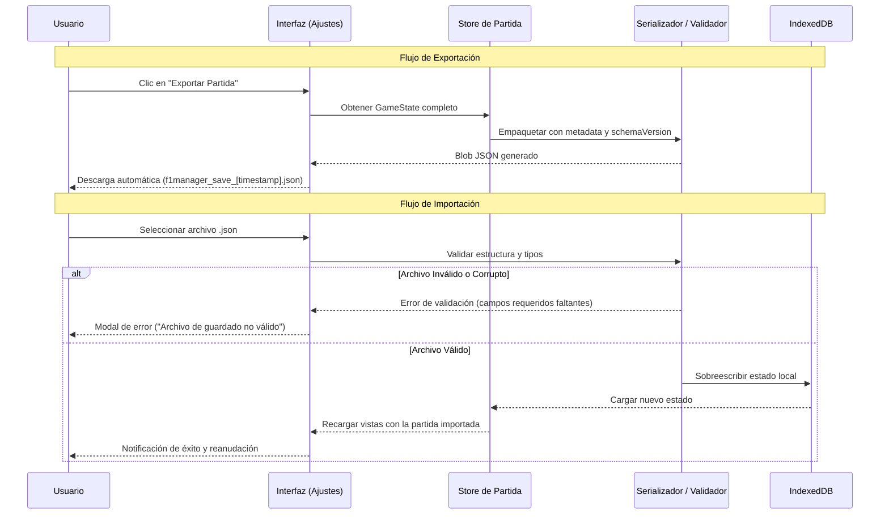

# Plan de Diseño Técnico: F1 Manager Web (Arcade)

| Documento | Plan de Arquitectura y Diseño Técnico (`plan.md`) |
| :--- | :--- |
| **Referencias** | [briefing.md](file:///home/cristian-dev/dev/f1manager/briefing.md) \| [prd.md](file:///home/cristian-dev/dev/f1manager/prd.md) \| [spec/domain-model.md](file:///home/cristian-dev/dev/f1manager/spec/domain-model.md) \| [spec/game-rules.md](file:///home/cristian-dev/dev/f1manager/spec/game-rules.md) \| [spec/acceptance-criteria.md](file:///home/cristian-dev/dev/f1manager/spec/acceptance-criteria.md) |
| **Estado** | Propuesta Técnica Aprobada |

---

## 1. Visión Técnica y Principios de Arquitectura

El objetivo técnico es construir una aplicación web ultra rápida, accesible y resiliente que funcione al 100% en el dispositivo del usuario sin dependencias de red ni servidores en la nube.

```
┌──────────────────────────────────────────────────────────────┐
│                    CAPA DE PRESENTACIÓN                      │
│      Next.js (App Router) + UI Components + CSS Moderno      │
└──────────────────────────────┬───────────────────────────────┘
                               │ (Invoca casos de uso / lee estado)
┌──────────────────────────────▼───────────────────────────────┐
│                    CAPA DE APLICACIÓN                        │
│         Gestor de Estado (Zustand Store) + Use Cases         │
└──────────────────────────────┬───────────────────────────────┘
                               │ (Ejecuta reglas y mutaciones puras)
┌──────────────────────────────▼───────────────────────────────┐
│                    CAPA DE DOMINIO (CORE)                    │
│      Entidades + Motor de Simulación + simulationConfig      │
└──────────────────────────────┬───────────────────────────────┘
                               │ (Persiste y recupera estado)
┌──────────────────────────────▼───────────────────────────────┐
│                  CAPA DE INFRAESTRUCTURA                     │
│    IndexedDB Storage + Export/Import JSON + Service Worker   │
└──────────────────────────────────────────────────────────────┘
```

### Principios Rectores:
1. **Client-Only & Cero Backend:** Compilación como sitio estático (`output: 'export'`) en Next.js. Todos los cálculos, simulaciones y datos viven y se ejecutan en el navegador del cliente.
2. **Offline-First Real (PWA):** Todo el paquete de recursos (código compilado, fuentes, hojas de estilo, assets gráficos de escuderías y circuitos) queda precacheado mediante un *Service Worker*. La aplicación puede instalarse y ejecutarse en modo avión.
3. **Arquitectura Hexagonal (Headless Game Engine):** La lógica del juego, las entidades y las matemáticas de simulación están completamente desacopladas de React y de cualquier API del DOM.
4. **Local-First Data Layer:** La fuente de la verdad reside en `IndexedDB`, con capacidades nativas de exportación e importación de archivos `.json` para salvaguarda y portabilidad.

---

## 2. Estructura de Carpetas del Proyecto

Se propone una estructura modular y limpia basada en *Screaming Architecture* dentro del directorio `src/`:

```
f1manager/
├── public/
│   ├── manifest.json              # Manifiesto de la PWA (nombre, iconos, display standalone)
│   ├── sw.js                      # Service Worker para cacheo y soporte offline
│   └── icons/                     # Iconos PWA y logotipos estáticos de circuitos/escuderías
├── src/
│   ├── app/                       # Enrutador de Next.js (App Router)
│   │   ├── layout.tsx             # Shell de la app, fuentes, metadatos SEO y registro PWA
│   │   ├── page.tsx               # Puerta de entrada: menú principal (Continuar / Nueva Partida)
│   │   ├── new-game/page.tsx      # Pantalla de selección de escudería oficial
│   │   ├── dashboard/page.tsx     # Panel principal (fábrica, finanzas, resumen)
│   │   ├── market/page.tsx        # Mercado de personal (fichajes y renovaciones)
│   │   ├── academy/page.tsx       # Gestión de la academia de jóvenes promesas
│   │   ├── race/page.tsx          # Simulación del Gran Premio (Qualy + Carrera + Pantalla final)
│   │   ├── standings/page.tsx     # Tablas de clasificación mundial de Pilotos y Constructores
│   │   ├── legacy/page.tsx        # Pantalla de Legado tras la temporada 10
│   │   └── settings/page.tsx      # Ajustes, reset y Exportar/Importar JSON
│   │
│   ├── domain/                    # NÚCLEO PURO DEL JUEGO (Sin dependencias de React ni Next.js)
│   │   ├── models/                # Tipos e interfaces (Team, Driver, Car, Circuit, etc.)
│   │   ├── simulation/            # Motor matemático (Qualy, Carrera, cálculo DNF e incidentes)
│   │   ├── economy/               # Lógica de balance, patrocinios, salarios y costes de DNF
│   │   ├── development/           # Lógica de mejoras del monoplaza, moral y reintentos
│   │   ├── academy/               # Generador procedural de jóvenes promesas y evolución
│   │   ├── season/                # Gestión del calendario de 24 citas, puntos FIA y transición anual
│   │   └── manager/               # Lógica del perfil de Team Principal y recálculo de tpRating
│   │
│   ├── config/                    # PARÁMETROS AJUSTABLES DE JUEGO
│   │   ├── simulationConfig.ts    # Pesos de Qualy/Carrera, sigmas, penalizaciones y límites
│   │   └── initialTeamsData.ts    # Datos base de las 10 escuderías reales de la temporada
│   │
│   ├── application/               # ORQUESTACIÓN Y ESTADO GLOBAL
│   │   ├── store/                 # Store de estado reactivo (Zustand) que expone el estado al UI
│   │   └── useCases/              # Casos de uso (startNewGame, runRaceWeekend, applyUpgrade, etc.)
│   │
│   ├── infrastructure/            # ACCESO A DATOS Y SERVICIOS DEL NAVEGADOR
│   │   ├── storage/               # Adaptador de persistencia IndexedDB
│   │   ├── serialization/         # Serializador, deserializador y validador de esquema JSON
│   │   └── pwa/                   # Utilidades de registro y ciclo de vida del Service Worker
│   │
│   └── presentation/              # COMPONENTES VISUALES Y UI
│       ├── components/            # Componentes reutilizables (Botones, Modales, Barras, Tarjetas)
│       └── styles/                # CSS Vanilla / Módulos de estilo inspirados en F1 Arcade
│
├── tests/                         # SUITE DE PRUEBAS AUTOMATIZADAS
│   ├── unit/                      # Pruebas unitarias de fórmulas de dominio y reglas
│   ├── integration/               # Pruebas de integración de casos de uso y persistencia
│   └── e2e/                       # Pruebas de extremo a extremo de flujos de usuario
├── package.json
└── tsconfig.json
```

---

## 3. Separación entre Lógica del Juego e Interfaz

### 3.1. Justificación de la Separación
Para garantizar que la lógica de simulación deportiva y las reglas económicas no se contaminen con los ciclos de renderizado de React, se establece una frontera estricta:
* **El Dominio (`src/domain/`) es JavaScript/TypeScript puro:**
  * No importa `react`, `next/navigation`, `document`, ni `window`.
  * Todas las funciones de simulación y cálculo financiero son funciones deterministas y sin efectos secundarios (reciben un estado y parámetros de configuración, devuelven un nuevo estado o resultado).
* **Beneficios técnicos directos:**
  1. **Velocidad de ejecución:** Pruebas unitarias ultrarrápidas en milisegundos sin necesidad de mockear el DOM.
  2. **Calibración aislada:** Se pueden balancear los pesos de carrera en `simulationConfig.ts` sin alterar ningún componente visual.
  3. **Portabilidad:** Si en el futuro se cambiara de framework visual o se empaquetara en Capacitor/Electron, el motor del juego permanecería intacto.

### 3.2. Puente entre Dominio y Presentación: Capa de Aplicación
* Se utiliza un gestor de estado ligero en cliente (**Zustand**):
  * Mantiene la copia en memoria de la partida activa (`GameState`).
  * Los componentes de React se suscriben selectivamente solo a los datos que necesitan renderizar (ej. el dinero en la barra superior o las posiciones en la pantalla de carrera).
  * Los eventos de la interfaz (ej. pulsar "Disputar Fin de Semana") invocan casos de uso en `src/application/useCases/`, los cuales ejecutan la lógica pura del dominio, obtienen el nuevo estado, lo actualizan en el store y ordenan su guardado asíncrono en la capa de persistencia.

---

## 4. Persistencia Local y Estrategia de Guardado

### 4.1. Almacenamiento Principal en IndexedDB
* **Tecnología seleccionada:** `IndexedDB` gestionada mediante la librería **`idb`** (envoltorio Promise ultraligero de ~1 KB sobre la API nativa del navegador). Si en fases posteriores la complejidad de consultas o migraciones lo justificara, se evaluará la transición a `Dexie.js`.
* **Justificación técnica:**
  * `localStorage` tiene un límite de cuota estricto (~5 MB), es síncrono y bloquea el hilo principal al serializar estados grandes con historiales de temporadas.
  * `IndexedDB` es asíncrono, no bloquea la interfaz y ofrece una cuota generosa (cientos de megabytes), ideal para persistir el historial completo de 10 temporadas con resultados, estadísticas y clasificaciones.

### 4.2. Estrategia de Guardado Automático (*Auto-Save*)
* **Persistencia por Evento Clave:** El guardado no se realiza por intervalo de tiempo ciego (*polling*), sino de forma transaccional inmediatamente después de cada acción clave del usuario:
  1. Confirmar selección de escudería inicial.
  2. Ordenar o reintentar una mejora técnica en la fábrica.
  3. Firmar o renovar un contrato de personal o academia.
  4. Concluir la simulación de un Gran Premio (clasificación y carrera).
  5. Completar la transición de fin de temporada.
* **Manejo de Concurrencia:** La escritura en `IndexedDB` se ejecuta de forma asíncrona en segundo plano sin interrumpir las animaciones ni la navegación del jugador (*optimistic state updates*).

---

## 5. Estrategia de Exportación / Importación (Portabilidad JSON)

Dado que no existe backend ni base de datos centralizada, la portabilidad y la seguridad de las partidas guardadas dependen de la exportación manual a JSON:



### 5.1. Esquema del Archivo de Exportación
El payload exportado contiene un envoltorio con metadatos:
* `schemaVersion`: Entero identificador de la versión de datos (ej. `1`).
* `exportedAt`: Marca temporal ISO-8601.
* `appVersion`: Versión del juego.
* `data`: Objeto completo que incluye el perfil del director, escuderías, pilotos, coches, circuito actual, temporada e histórico de resultados.

### 5.2. Validación Estricta con Zod en la Importación
* Antes de volcar cualquier archivo en `IndexedDB`, el motor ejecuta una validación exhaustiva de esquema en memoria mediante **`Zod`** (`saveGameSchema`):
  * Comprueba que los campos obligatorios existan y posean los tipos correctos (`string`, `number`, `boolean`, `array`).
  * Valida que los valores numéricos se encuentren dentro de rangos lógicos reglamentarios (ej. atributos entre 1 y 100, temporadas entre 1 y 10).
  * Si la validación falla, `Zod` genera un informe descriptivo del error, se aborta inmediatamente la operación sin alterar el almacenamiento local previo y se notifica al usuario (*"Archivo de guardado no válido"*).

---

## 6. Estrategia de Pruebas (Testing Strategy)

Se define una pirámide de pruebas automatizadas con tres niveles de verificación orientados a cumplir los criterios de aceptación de [spec/acceptance-criteria.md](file:///home/cristian-dev/dev/f1manager/spec/acceptance-criteria.md):

```
       / \
      / E2E \       --> Playwright (Flujos de usuario, offline y persistencia)
     /───────\
    / Integr. \     --> Vitest + fake-indexeddb (Transición anual, casos de uso)
   /───────────\
  /   Unitarias \   --> Vitest (Fórmulas puras, DNF, economía, generador)
 /───────────────\
```

### 6.1. Pruebas Unitarias (Capa de Dominio)
* **Herramienta:** **Vitest**.
* **Objetivo:** Cobertura del 100% en las fórmulas y reglas de negocio descritas en [spec/game-rules.md](file:///home/cristian-dev/dev/f1manager/spec/game-rules.md):
  * **Simulación de Qualy y Carrera:** Verificación de que los pesos de `simulationConfig.ts` se aplican correctamente, que los puntos se reparten conforme a la escala FIA y que los factores aleatorios respetan las distribuciones esperadas.
  * **Cálculo de DNF y Sanciones:** Verificación de que la probabilidad de abandono responde a fiabilidad/consistencia y que el coste de reparación escala con el valor acumulado del monoplaza.
  * **Economía y Bancarrota:** Comprobación del límite de deuda porcentual sobre el presupuesto base y detección de condiciones de quiebra.
  * **Moral del Ingeniero Jefe:** Verificación de la probabilidad de éxito/fallo, la penalización de $-3$ puntos de moral y el descuento del $50\%$ en reintentos.
  * **Generación Procedural:** Verificación de que los jóvenes talentos se generan con nombres ficticios, edades entre 16 y 19 años y atributos coherentes.

### 6.2. Pruebas de Integración (Capa de Aplicación y Persistencia)
* **Herramientas:** **Vitest** + **`fake-indexeddb`**.
* **Objetivo:** Validar la orquestación entre múltiples módulos:
  * Ejecutar un fin de semana completo de carreras (Qualy $\rightarrow$ Carrera $\rightarrow$ Finanzas $\rightarrow$ Persistencia).
  * Simular la transición de la ronda 24 a la siguiente temporada: cobro de premios, envejecimiento de pilotos, movilidad de escuderías según `tpRating` y llegada a la temporada 10 con despliegue de la pantalla de legado.
  * Probar el ciclo completo de exportación a JSON y reimportación garantizando paridad idéntica del estado.

### 6.3. Pruebas de Extremo a Extremo (E2E)
* **Herramienta:** **Playwright**.
* **Objetivo:** Validar los flujos de usuario reales descritos en [spec/user-flows.md](file:///home/cristian-dev/dev/f1manager/spec/user-flows.md) en un navegador real:
  * **Flujo de Nueva Partida:** Selección de escudería y arranque en el panel de fábrica.
  * **Flujo de Fin de Semana de Carreras:** Pulsar disputar GP, revisar parrilla, simular carrera y continuar.
  * **Resiliencia Offline:** Cargar la web, desconectar la red del navegador (modo offline emulado) y comprobar que la aplicación sigue respondiendo, simulando carreras y guardando datos en `IndexedDB`.
  * **Descarga y Carga de Archivo:** Comprobar que el botón de exportar dispara la descarga del fichero `.json` y que la carga restaura el progreso.

---

## 7. Justificación de Decisiones Técnicas

| Decisión Técnica | Alternativa Descartada | Justificación |
| :--- | :--- | :--- |
| **Next.js con exportación estática (`output: 'export'`)** | Single Page Application estándar con Vite | Next.js permite estructurar el proyecto mediante el App Router, optimizar metadatos y manifiestos para PWA, y compilar a un bundle 100% estático que puede servirse en cualquier CDN o ejecutarse offline sin servidor Node.js. |
| **IndexedDB con idb en lugar de localStorage** | `localStorage` nativo / Dexie.js inicial | `idb` aporta una capa Promise de ~1 KB sobre la API asíncrona nativa sin sobrecarga de dependencias. Evita bloqueos en el hilo de renderizado y el límite de 5 MB. Dexie.js se mantiene como alternativa futura si se requiriese un ORM más complejo. |
| **Zustand para estado en cliente** | React Context API / Redux Toolkit | Zustand es extremadamente liviano (<2 kB), no requiere boilerplate excesivo y permite invocar acciones fuera de los componentes React (ideal para coordinar casos de uso desacoplados). |
| **Vitest en lugar de Jest** | Jest tradicional | Vitest ofrece compatibilidad nativa con TypeScript y módulos ESM, arranque instantáneo sin configuración pesada de Babel y velocidad superior en pruebas unitarias de dominio. |
| **Validación por esquema con Zod** | Lectura directa de JSON (`JSON.parse`) | Evita corrupción del estado local y fallos en cascada en la UI si el usuario carga un archivo alterado o incompatible, garantizando tipado bidireccional automático en TypeScript. |
| **Gestión PWA y Service Worker con Serwist** | Implementación manual pura de Service Worker | `@serwist/next` automatiza la generación del manifiesto de precacheo estático para Next.js, sincroniza hashes de assets tras cada build y gestiona el ciclo de vida de la PWA de forma robusta y probada. |

---

## 8. Estado de Decisiones Técnicas

Todas las dudas técnicas de arquitectura para el arranque del MVP han quedado formalizadas y resueltas:

| Decisión Técnica | Elección Adoptada | Justificación |
| :--- | :--- | :--- |
| **Abstracción IndexedDB** | **`idb`** (inicialmente) | Máxima ligereza (~1 KB) y transparencia para SSG; se valorará `Dexie.js` si la complejidad a futuro lo demanda. |
| **Validación de Esquema JSON** | **`Zod`** | Inferencia directa de tipos TypeScript y validación runtime estricta a prueba de fallos. |
| **PWA / Service Worker** | **`serwist`** (`@serwist/next`) | Automatización completa del precacheo offline de assets estáticos y páginas en Next.js. |
