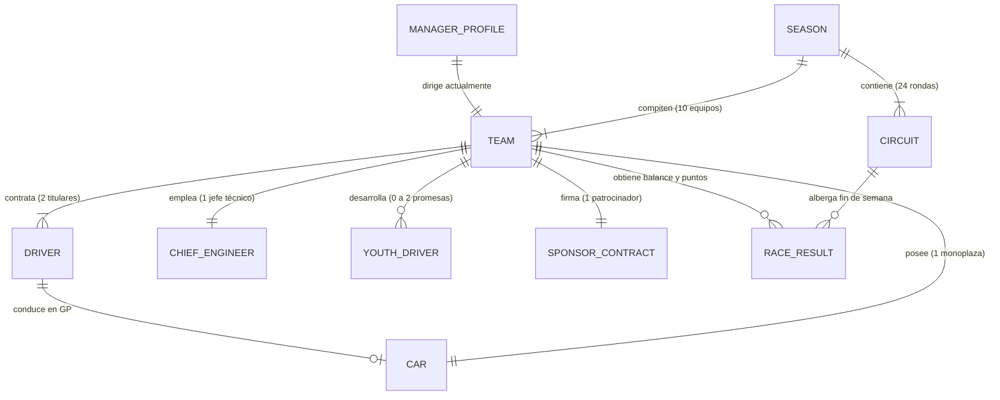

# Modelo de Dominio: F1 Manager Web (Arcade)

| Documento | Modelo Conceptual de Entidades y Relaciones (`spec/domain-model.md`) |
| :--- | :--- |
| **Referencias** | [briefing.md](file:///home/cristian-dev/dev/f1manager/briefing.md) \| [prd.md](file:///home/cristian-dev/dev/f1manager/prd.md) \| [spec/scope.md](file:///home/cristian-dev/dev/f1manager/spec/scope.md) |
| **Versión** | 1.0 (MVP) |

---

## 1. Diagrama de Relaciones del Dominio

---

## 2. Catálogo de Entidades del Dominio

### 2.1. Equipo (`Team`)
Representa una de las 10 escuderías de la temporada oficial de F1.
* **Atributos y Cualidades Básicas:**
  * `id`: Identificador único de la escudería.
  * `name`: Nombre oficial real del equipo (ej. Ferrari, Red Bull, Mercedes, etc.).
  * `budget`: Saldo disponible en cuenta bancaria.
  * `baseBudget`: Presupuesto de referencia de inicio de temporada (utilizado para calcular el umbral porcentual de bancarrota).
  * `boardExpectations`: Objetivo deportivo fijado por la directiva (ej. posición mínima en el Mundial de Constructores).
  * `reputation`: Nivel de prestigio base (influye en negociaciones y patrocinadores).
  * `factoryLevel`: Nivel de fábrica (acelera y abarata paquetes de desarrollo del coche).
  * `simulatorLevel`: Nivel de simulador (potencia la ganancia de experiencia de pilotos y academia).
* **Relaciones:**
  * Posee exactamente **1 Coche** (`Car`).
  * Emplea a **2 Pilotos Titulares** (`Driver`).
  * Emplea a **1 Jefe de Ingenieros** (`ChiefEngineer`).
  * Alberga de **0 a 2 Jóvenes Promesas** (`YouthDriver`) en su academia.
  * Mantiene activo **1 Contrato de Patrocinador** (`SponsorContract`).
  * Es dirigido por **1 Director Deportivo** (`ManagerProfile`) en la partida en curso.

---

### 2.2. Piloto Titular (`Driver`)
Representa a un piloto profesional que compite activamente en la parrilla oficial.
* **Atributos y Cualidades Básicas:**
  * `id`: Identificador único.
  * `name`: Nombre y apellidos del piloto real.
  * `age`: Edad.
  * `nationality`: País de origen.
  * `pace`: Ritmo y velocidad pura en pista (cualidad clave para tiempos de Qualy y ritmo de Carrera).
  * `consistency`: Consistencia (reduce la probabilidad de errores no forzados y accidentes).
  * `potential`: Margen de crecimiento o techo de progresión anual.
  * `morale`: Estado anímico actual (fluctúa según cumplimiento de expectativas y resultados recientes).
  * `salary`: Salario anual fijado por temporada.
  * `contractYears`: Años de contrato restantes con el equipo actual.
* **Relaciones:**
  * Pertenece a **1 Equipo** (`Team`) como titular o se encuentra en la **Agencia Libre** (sin equipo).
  * Pilota el coche de su escudería durante cada sesión de clasificación y carrera.

---

### 2.3. Jefe de Ingenieros (`ChiefEngineer`)
Líder del departamento técnico responsable de la evolución mecánica y la puesta a punto del monoplaza.
* **Atributos y Cualidades Básicas:**
  * `id`: Identificador único.
  * `name`: Nombre del ingeniero.
  * `developmentEfficiency`: Eficiencia de desarrollo (acelera los plazos de entrega y reduce el coste de las piezas del coche).
  * `setupPerformance`: Capacidad de puesta a punto (bonifica el rendimiento del monoplaza adaptándolo a las exigencias del circuito).
  * `morale`: Estado anímico actual (fluctúa según resultados deportivos y éxitos/fracasos técnicos; determina probabilísticamente si una mejora en desarrollo resulta exitosa o fallida).
  * `salary`: Salario anual por temporada.
  * `contractYears`: Años de contrato vigentes.
* **Relaciones:**
  * Asignado a **1 Equipo** (`Team`) o disponible en el mercado de personal.

---

### 2.4. Coche (`Car`)
Monoplaza de competición desarrollado y mantenido por la escudería.
* **Atributos y Cualidades Básicas:**
  * `id`: Identificador único.
  * `topSpeed`: Nivel cuantitativo de velocidad punta en rectas.
  * `downforce`: Nivel cuantitativo de carga aerodinámica y agarre en curva.
  * `reliability`: Porcentaje de fiabilidad mecánica (amortigua la probabilidad de fallos mecánicos o averías).
  * `upgradesInProgress`: Lista de proyectos de desarrollo activos (máximo 2 simultáneos, condicionado a fondos suficientes; cada proyecto registra atributo objetivo y Grandes Premios restantes para su entrega).
* **Relaciones:**
  * Pertenece a exactamente **1 Equipo** (`Team`).
  * Es compartido por los dos pilotos titulares de la escudería en cada Gran Premio.

---

### 2.5. Circuito (`Circuit`)
Trazado oficial donde se disputa un fin de semana de Gran Premio.
* **Atributos y Cualidades Básicas:**
  * `id`: Identificador único.
  * `name`: Nombre oficial del Gran Premio y del circuito.
  * `country`: País anfitrión.
  * `round`: Número de ronda dentro del calendario anual (1 a 24).
  * `laps`: Número representativo de vueltas del Gran Premio.
  * `topSpeedDemand`: Coeficiente de exigencia en velocidad punta (demanda de rectas largas).
  * `downforceDemand`: Coeficiente de exigencia en carga aerodinámica (curvas lentas y enlazadas).
  * `reliabilityDemand`: Grado de severidad para la mecánica (probabilidad base de incidencias mecánicas).
* **Relaciones:**
  * Forma parte de una **Temporada** (`Season`).
  * Sirve de escenario para generar el resultado de carrera y clasificación de los 10 equipos y 20 pilotos.

---

### 2.6. Joven Promesa (`YouthDriver`)
Piloto en formación perteneciente a la cantera de talentos de la escudería.
* **Atributos y Cualidades Básicas:**
  * `id`: Identificador único.
  * `name`: Nombre ficticio generado proceduralmente.
  * `age`: Edad inicial juvenil (16 a 19 años).
  * `nationality`: Nacionalidad procedural.
  * `pace`: Nivel base bajo de ritmo.
  * `consistency`: Nivel base inicial de consistencia.
  * `potential`: Margen de desarrollo elevado.
  * `morale`: Estado anímico.
  * `financialCost`: Coste operativo cubierto íntegramente por el mantenimiento de las instalaciones del Simulador (sin salario individual independiente).
* **Relaciones:**
  * Pertenece a la academia de **1 Equipo** (`Team`) (límite de 2 por escudería) o forma parte del catálogo de promesas anuales libres.
  * Puede ser promocionado para transformarse en **Piloto Titular** (`Driver`) cuando exista un asiento vacante.

---

### 2.7. Patrocinador (`SponsorContract`)
Acuerdo comercial que inyecta ingresos financieros al equipo.
* **Atributos y Cualidades Básicas:**
  * `id`: Identificador único del patrocinador.
  * `name`: Nombre de la marca comercial.
  * `baseIncomePerRace`: Cantidad fija garantizada a ingresar tras cada Gran Premio disputado.
  * `bonusTarget`: Meta de rendimiento exigida (ej. "Ambos coches en Top 10" o "1 coche en el podio").
  * `bonusIncome`: Suma monetaria adicional que se liquida si se cumple la meta.
  * `remainingRaces`: Número de Grandes Premios de vigencia antes de finalizar el contrato.
* **Relaciones:**
  * Firmado con **1 Equipo** (`Team`).

---

### 2.8. Temporada (`Season`)
Unidad temporal que articula el campeonato del mundo a lo largo del año.
* **Atributos y Cualidades Básicas:**
  * `seasonNumber`: Año en curso del juego (1 a 10).
  * `currentRaceIndex`: Índice del Gran Premio activo (0 a 23).
  * `driverStandings`: Tabla de clasificación de pilotos con puntos acumulados.
  * `constructorStandings`: Tabla de clasificación de constructores con puntos acumulados.
* **Relaciones:**
  * Contiene los **24 Circuitos** (`Circuit`) en orden cronológico oficial.
  * Agrupa a los **10 Equipos** (`Team`) y sus **20 Pilotos Titulares** (`Driver`).

---

### 2.9. Perfil del Team Principal (`ManagerProfile`)
Representación del jugador dentro del universo del juego.
* **Atributos y Cualidades Básicas:**
  * `id`: Identificador único.
  * `name`: Nombre del jugador / director.
  * `tpRating`: Atributo numérico oculto (0 a 100) que calibra la reputación y éxito del jugador.
  * `seasonsCompleted`: Contador de temporadas completadas (máx. 10).
  * `trophyCabinet`: Palmarés histórico (Mundiales de Pilotos, Mundiales de Constructores, victorias y podios totales).
* **Relaciones:**
  * Dirige a **1 Equipo** (`Team`) en la temporada activa.
  * Puede cambiar de equipo entre temporadas en función de su `tpRating`.

---

## 3. Matriz de Cardinalidades entre Entidades

| Entidad Origen | Relación | Entidad Destino | Cardinalidad | Restricción del Dominio |
| :--- | :---: | :--- | :---: | :--- |
| **Team** | posee | **Car** | 1 : 1 | Cada equipo gestiona un único modelo de monoplaza activo. |
| **Team** | contrata | **Driver** | 1 : 2 | La escudería requiere exactamente 2 pilotos titulares en parrilla. |
| **Team** | emplea | **ChiefEngineer** | 1 : 1 | Un único jefe técnico a cargo de fábrica y desarrollo. |
| **Team** | desarrolla | **YouthDriver** | 1 : 0..2 | Límite estricto de máximo 2 promesas simultáneas en academia. |
| **Team** | firma | **SponsorContract** | 1 : 1 | Un patrocinador principal activo en el MVP. |
| **Car** | desarrolla | **UpgradeProject** | 1 : 0..2 | Límite de hasta 2 desarrollos técnicos en paralelo con fondos suficientes. |
| **Season** | alberga | **Circuit** | 1 : 24 | Calendario oficial completo de 24 citas mundiales. |
| **Season** | compiten | **Team** | 1 : 10 | Las 10 escuderías oficiales de la Fórmula 1. |
| **ManagerProfile** | gestiona | **Team** | 1 : 1 | El jugador solo lidera 1 equipo de forma simultánea. |

---

## 4. Estado de Decisiones del Modelo

Todas las dudas conceptuales sobre las entidades y relaciones del MVP han quedado formalizadas y cerradas:

| Decisión del Modelo | Resolución Adoptada | Entidad Afectada |
| :--- | :--- | :--- |
| **Coste de Jóvenes Promesas** | Sin salario individual; mantenimiento cubierto por el coste de las instalaciones del Simulador. | `YouthDriver`, `Team.facilities` |
| **Moral del Jefe de Ingenieros** | Se añade atributo `morale`, el cual determina probabilísticamente si una mejora resulta exitosa o fallida. | `ChiefEngineer` |
| **Límite de Desarrollos Simultáneos** | Máximo de 2 proyectos de desarrollo técnico en paralelo en el coche, condicionado a fondos disponibles. | `Car.upgradesInProgress` |