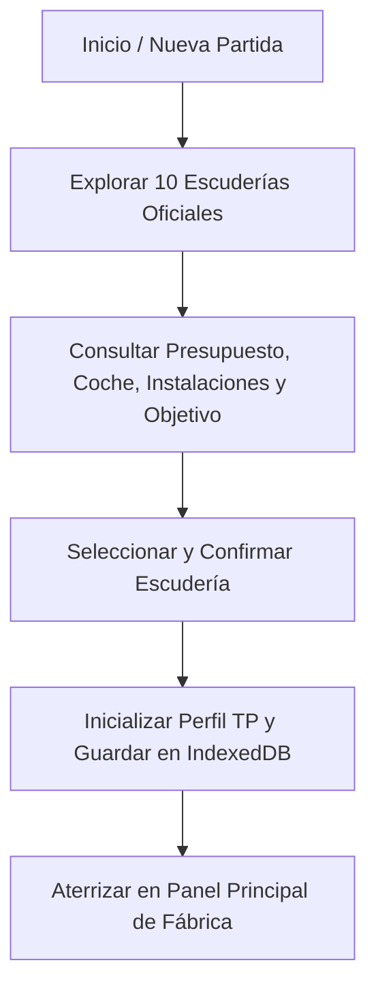
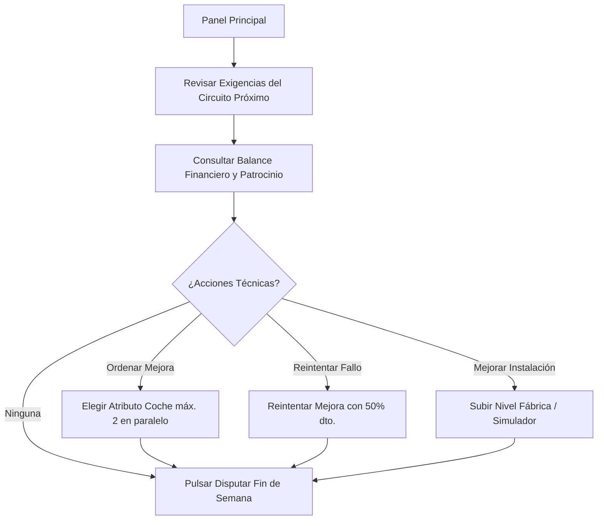
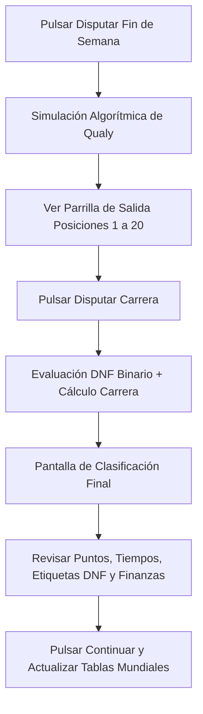
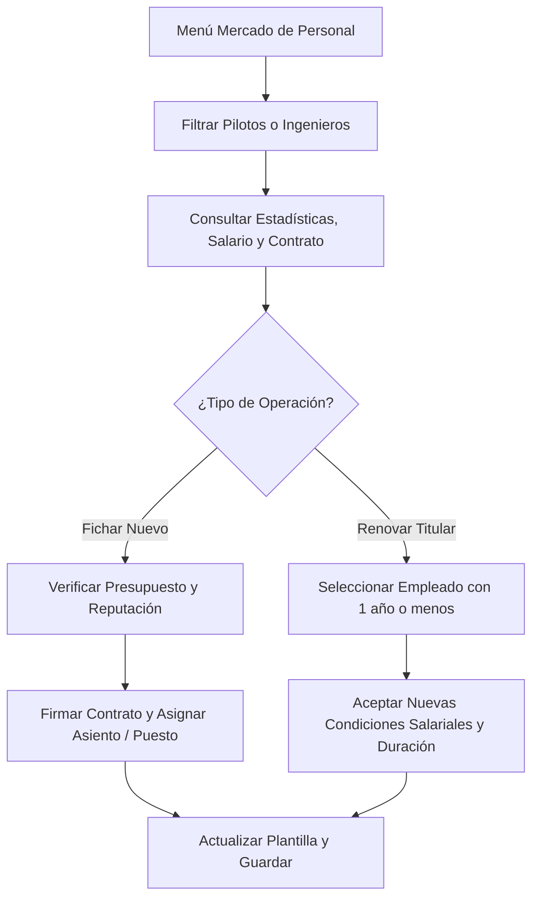
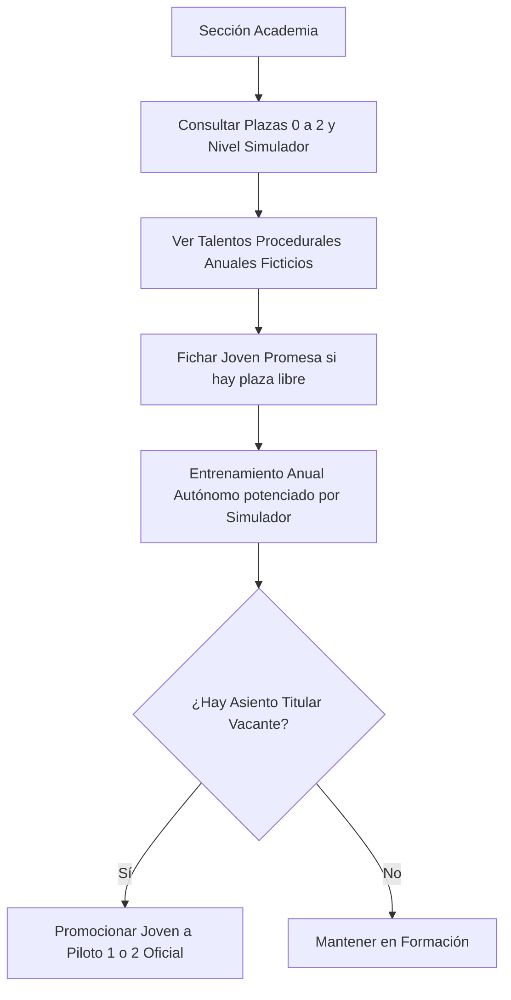
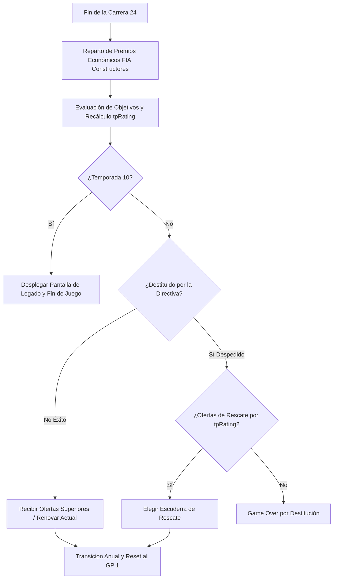
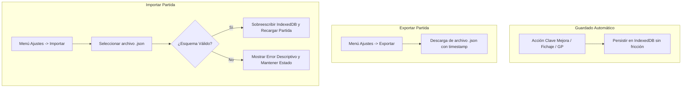

# Flujos de Usuario: F1 Manager Web (Arcade)

| Documento | Especificación de Flujos Principales del Jugador (`spec/user-flows.md`) |
| :--- | :--- |
| **Referencias** | [briefing.md](file:///home/cristian-dev/dev/f1manager/briefing.md) \| [prd.md](file:///home/cristian-dev/dev/f1manager/prd.md) \| [spec/scope.md](file:///home/cristian-dev/dev/f1manager/spec/scope.md) \| [spec/game-rules.md](file:///home/cristian-dev/dev/f1manager/spec/game-rules.md) |
| **Versión** | 1.0 (MVP) |

---

## Flujo 1: Empezar Partida y Elegir Escudería

### Objetivo
Permitir al jugador iniciar una nueva trayectoria profesional eligiendo cualquiera de las escuderías oficiales de la Fórmula 1.

### Pasos Detallados
1. **Entrada:** El jugador abre la aplicación web por primera vez o pulsa "Nueva Partida" en el menú principal.
2. **Presentación de la Parrilla:** El sistema presenta las 10 escuderías de la temporada oficial de F1. Para cada equipo se exponen sus datos de partida:
   * Nombre de la escudería real.
   * Presupuesto bancario inicial.
   * Nivel base de los atributos del monoplaza (*Top Speed*, *Downforce*, *Reliability*).
   * Nivel de Fábrica y Simulador.
   * Objetivo de temporada fijado por la junta directiva (ej. *"Campeón de Constructores"*, *"Top 5"* o *"Evitar el farolillo rojo"*).
3. **Selección:** El jugador navega entre las opciones, selecciona la escudería deseada y pulsa "Confirmar Escudería".
4. **Inicialización del Estado:**
   * El sistema genera el perfil de Team Principal (`ManagerProfile`) asignando el `tpRating` oculto correspondiente a la dificultad del equipo elegido.
   * Carga la plantilla oficial (2 pilotos titulares y 1 jefe de ingenieros).
   * Fija la Temporada 1 en la Ronda 1 (primer Gran Premio del calendario oficial).
   * Persiste automáticamente el estado en `IndexedDB`.
5. **Salida:** El jugador accede al **Panel Principal de Gestión** listo para comenzar los preparativos de la temporada.

---

## Flujo 2: Preparar el Gran Premio (Fábrica, Finanzas e Instalaciones)

### Objetivo
Gestionar los recursos técnicos y económicos del equipo antes de lanzarse a la pista.

### Pasos Detallados
1. **Análisis del Trazado:** En el panel principal, el jugador consulta los datos del siguiente circuito del calendario (ronda actual, país, número de vueltas y exigencias de velocidad punta, carga aerodinámica y fiabilidad mecánica).
2. **Revisión Financiera:** El jugador comprueba su saldo disponible, los costes operativos fijos y la meta del contrato de patrocinio activo.
3. **Gestión de Mejoras Técnicas (Opcional):**
   * El jugador accede a la Fábrica para encargar mejoras sobre *Top Speed*, *Downforce* o *Reliability*.
   * El sistema verifica que haya fondos suficientes y que no se superen las **2 mejoras simultáneas** activas.
   * El jugador confirma la orden; se descuenta el coste y se inicia el plazo de entrega medido en Grandes Premios.
4. **Reintento de Mejoras Fallidas (Opcional):**
   * Si en la carrera previa una mejora resultó fallida por la moral del ingeniero jefe, el jugador puede pulsar "Reintentar Mejora" sobre la misma pieza aprovechando un **50% de descuento económico**.
5. **Ampliación de Instalaciones (Opcional):**
   * Con fondos suficientes, el jugador puede aumentar el nivel de la Fábrica (para abaratar y acelerar futuros desarrollos) o del Simulador (para potenciar la academia y los pilotos).
6. **Lanzamiento:** Con los preparativos concluidos, el jugador pulsa **"Disputar Fin de Semana"**.

---

## Flujo 3: Simular Carrera y Ver Clasificación

### Objetivo
Simular de forma ágil y automática la sesión de Clasificación y la Carrera, visualizando la clasificación final con consecuencias financieras y deportivas directas.

### Pasos Detallados
1. **Simulación de Clasificación (Qualy):**
   * El sistema calcula el orden de salida combinando los atributos del coche, el talento del piloto y la adecuación al circuito, con el factor estocástico y la evaluación de incidentes.
   * Se muestra la **Parrilla de Salida** ordenada del 1º al 20º puesto.
2. **Acceso a Carrera:** El jugador revisa la posición de salida de sus monoplazas y pulsa **"Ir a Carrera"**.
3. **Simulación de Carrera:**
   * El motor de simulación evalúa la probabilidad de abandono (DNF) de cada coche. Si hay rotura o accidente, el piloto queda fuera de combate con su etiqueta tipificada (*"Fallo mecánico"* o *"Accidente"*).
   * Para los monoplazas en carrera, se calcula el índice de rendimiento final combinando la posición de parrilla, coche, talento/moral del piloto y circuito.
4. **Pantalla de Clasificación Final:**
   * **Tabla de Resultados:** Orden de llegada del 1º al 20º puesto, podio destacado, tiempos/diferencias y pilotos DNF con su etiqueta corta correspondiente.
   * **Puntos FIA:** Asignación de puntos oficiales de F1 (25, 18, 15...) a los 10 primeros clasificados.
   * **Liquidación Económica del GP:** Ingreso base del patrocinador, ingreso del bonus (si se alcanzó la meta) y descuento de la sanción económica de reparación si algún coche del equipo sufrió DNF (proporcional al nivel de mejora del monoplaza).
5. **Cierre del Gran Premio:**
   * El jugador pulsa **"Continuar"**.
   * El sistema suma los puntos a los Mundiales de Pilotos y Constructores, aplica la variación de moral ($\pm 5$ puntos según expectativas), avanza el calendario a la siguiente ronda y guarda el estado en `IndexedDB`.

---

## Flujo 4: Fichar y Renovar Personal (Pilotos e Ingenieros)

### Objetivo
Optimizar el talento del equipo contratando nuevos profesionales o blindando a los titulares actuales.

### Pasos Detallados
1. **Acceso al Mercado:** El jugador entra en la sección de Personal y navega entre las listas de Pilotos e Ingenieros.
2. **Evaluación de Candidatos:**
   * Para pilotos: consulta *Pace*, *Consistency*, *Potential*, *Morale*, salario solicitado y duración de contrato.
   * Para ingenieros: consulta *Development Efficiency*, *Setup Performance*, *Morale*, salario y duración.
3. **Fichaje de un Nuevo Empleado:**
   * El jugador selecciona al candidato deseado y pulsa "Contratar".
   * El sistema comprueba que el saldo bancario cubra el salario anual y que el prestigio del equipo satisfaga las exigencias del profesional.
   * El jugador selecciona a quién sustituye (asumiendo el finiquito correspondiente si el contrato saliente estaba vigente).
   * El nuevo empleado firma por 1 a 3 temporadas y se incorpora inmediatamente.
4. **Renovación de Empleados Actuales:**
   * El jugador localiza en su plantilla a empleados con 1 año o menos de contrato restante.
   * Pulsa "Ofrecer Renovación", acepta las pretensiones salariales y confirma la extensión de temporadas.

---

## Flujo 5: Gestionar la Academia de Jóvenes Promesas

### Objetivo
Otear, fichar y desarrollar a futuros talentos para promocionarlos a la alineación oficial.

### Pasos Detallados
1. **Revisión de la Cantera:** El jugador accede al panel de la Academia, donde visualiza el nivel actual del Simulador y las plazas ocupadas (máximo 2 simultáneas).
2. **Exploración de la Hornada Anual:** El sistema expone la lista de pilotos ficticios generados proceduralmente esa temporada (jóvenes de 16-19 años con *Pace* y *Consistency* bajos pero muy alto *Potential*).
3. **Fichaje:** Si la academia tiene una plaza libre, el jugador selecciona a un joven y pulsa "Fichar para la Academia". Su incorporación no genera salario extra, ya que queda absorbido por el coste de mantenimiento del Simulador.
4. **Desarrollo Automático:** Al final de cada temporada, el sistema aplica la ganancia anual de atributos a las promesas en función de su potencial y del nivel del Simulador.
5. **Promoción a Titular:** Cuando se produce una vacante en los asientos titulares (por despido o no renovación de un titular), el jugador pulsa "Promocionar a Titular" sobre la joven promesa, pasando a ser piloto titular de F1 y liberando una vacante en la academia.

---

## Flujo 6: Pasar de Temporada, Movilidad de Equipo y Pantalla de Legado

### Objetivo
Liquidar el campeonato anual, evaluar la continuidad del Director Deportivo y cerrar la trayectoria tras la temporada 10.

### Pasos Detallados
1. **Cierre de Temporada:** Al completarse la carrera 24, el sistema declara las posiciones finales de los Campeonatos Mundiales de Pilotos y de Constructores, ingresando en el balance de cada equipo el premio económico reglamentario de la FIA.
2. **Evaluación de la Junta Directiva:**
   * La directiva compara la posición final en Constructores con el objetivo fijado a inicio de año.
   * Se actualiza el rating oculto de Team Principal (`tpRating`): sube si se cumplieron o superaron las metas, o cae si se fracasó.
3. **Bifurcación de Temporada 10:**
   * Si la temporada recién terminada es la **Temporada 10**, se bloquea el avance anual y se despliega directamente la **Pantalla de Legado**, mostrando el palmarés histórico del jugador (mundiales ganados, victorias, podios, escuderías dirigidas y título honorífico final).
4. **Bifurcación de Continuidad y Movilidad (Temporadas 1 a 9):**
   * **Caso A (Continuidad y Ofertas Externas):** Si el jugador cumplió los objetivos, la directiva le ofrece renovar. Además, si su `tpRating` es alto, escuderías de mayor o igual prestigio le envían ofertas formales. El jugador elige entre quedarse o cambiar de escudería para el nuevo año.
   * **Caso B (Destitución y Ofertas de Rescate):** Si el jugador es despedido por incumplimiento de objetivos, el sistema comprueba su `tpRating`. Si califica para escuderías más modestas, recibe ofertas de rescate para tomar las riendas de un nuevo equipo.
   * **Caso C (Game Over):** Si tras ser despedido ninguna escudería de la parrilla le ofrece contrato (o si cayó en bancarrota insalvable), la partida termina con pantalla de derrota.
5. **Transición al Nuevo Año:** Se descuenta un año a todos los contratos, se genera la nueva hornada de jóvenes promesas y se inicializa la Ronda 1 del nuevo calendario.

---

## Flujo 7: Guardado, Exportar e Importar Partida

### Objetivo
Garantizar la persistencia continua en el dispositivo y permitir respaldar o transferir la partida en formato JSON.

### Pasos Detallados
1. **Guardado Automático Continuo:** Cada vez que el jugador completa una mejora, firma un contrato o disputa una sesión, el estado íntegro se guarda de forma transparente en `IndexedDB`. Al recargar o reabrir el navegador, se pulsa "Continuar" para reanudar exactamente en el mismo instante.
2. **Exportar Partida (Copia de Seguridad):**
   * El jugador abre el menú de Ajustes y pulsa **"Exportar Partida"**.
   * El sistema genera y descarga automáticamente un archivo `f1manager_save_[timestamp].json` conteniendo la partida completa.
3. **Importar Partida (Restauración):**
   * El jugador pulsa **"Importar Partida"** y selecciona un archivo `.json` de su dispositivo.
   * El sistema valida la integridad de la estructura y el esquema de datos.
   * **Si es válido:** sobreescribe la base de datos local en `IndexedDB`, recarga la aplicación y sitúa al jugador en su partida importada.
   * **Si es inválido o corrupto:** bloquea la operación, muestra un mensaje de error claro en pantalla (*"Archivo de guardado no válido"*) y preserva la partida que estuviera activa sin dañarla.
