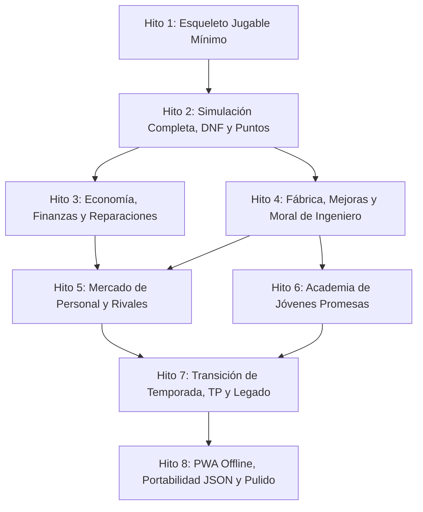

# Plan de Tareas del MVP: F1 Manager Web (Arcade)

| Documento | Desglose de Tareas y Dependencias (`tasks.md`) |
| :--- | :--- |
| **Referencias** | [plan.md](file:///home/cristian-dev/dev/f1manager/plan.md) \| [spec/acceptance-criteria.md](file:///home/cristian-dev/dev/f1manager/spec/acceptance-criteria.md) \| [spec/game-rules.md](file:///home/cristian-dev/dev/f1manager/spec/game-rules.md) |
| **Versión** | 1.0 (MVP) |

---

## Mapa de Dependencias entre Hitos

---

## Hito 1: Esqueleto Jugable Mínimo (*Walking Skeleton*)

**Objetivo del hito:** Disponer de una primera versión jugable de extremo a extremo: arrancar la app, seleccionar una escudería oficial, disputar el Gran Premio 1 (Qualy + Carrera básica), ver la clasificación final y comprobar que el estado persiste al recargar la página.

### Tarea 1.1: Inicialización del Proyecto y Configuración Base
* **Descripción:** Inicializar el proyecto con Next.js (App Router), TypeScript, configuración de exportación estática (`output: 'export'`) y setup de pruebas con Vitest.
* **Criterios de Aceptación:** Base técnica para `AC-09.1`.
* **Verificación:** Ejecutar `npm run build` verificando que genera el bundle estático en `out/` y ejecutar `npx vitest run` comprobando que el test runner pasa.
* **Estado:** Completada y verificada.

### Tarea 1.2: Definición de Tipos de Dominio y Catálogo Inicial
* **Descripción:** Crear los tipos TypeScript puros (`Team`, `Driver`, `ChiefEngineer`, `Car`, `Circuit`, `GameState`) y el fichero de datos iniciales (`src/config/initialTeamsData.ts`) con las 10 escuderías oficiales, sus 20 pilotos titulares, coches base y el calendario de 24 circuitos.
* **Criterios de Aceptación:** `AC-01.1`.
* **Verificación:** Test unitario que valida que el catálogo contiene exactamente 10 equipos, 20 pilotos y 24 circuitos con todos los atributos requeridos.
* **Estado:** Completada y verificada.

### Tarea 1.3: Motor Básico de Simulación (Qualy y Carrera)
* **Descripción:** Implementar las funciones de cálculo puras en `src/domain/simulation/` para determinar los tiempos de Qualy y el orden de llegada en carrera según monoplaza, piloto y circuito, utilizando las ponderaciones de `simulationConfig.ts`.
* **Criterios de Aceptación:** `AC-06.1`, `AC-06.6`.
* **Verificación:** Test unitario que simula una sesión de clasificación y carrera comprobando que genera un orden de 1 a 20 determinista y coherente con las estadísticas.
* **Estado:** Completada y verificada.

### Tarea 1.4: Capa de Persistencia Local Básica y Store Global
* **Descripción:** Configurar `IndexedDB` con la librería `idb` y el store reactivo en cliente con `Zustand` para almacenar y recuperar el estado de la partida activa.
* **Criterios de Aceptación:** `AC-09.1`, `AC-09.2`.
* **Verificación:** Test de integración con `fake-indexeddb` que guarda una partida, recarga el store y valida la paridad de los datos.
* **Estado:** Completada y verificada.

### Tarea 1.5: Pantalla de Selección de Escudería
* **Descripción:** Crear la vista inicial (`/new-game`) donde el usuario visualiza las 10 escuderías oficiales con su presupuesto, nivel de coche y objetivo de la directiva, y puede seleccionar una para iniciar partida.
* **Criterios de Aceptación:** `AC-01.1`, `AC-01.2`, `AC-01.3`.
* **Verificación:** Flujo manual: abrir la app, seleccionar una escudería, pulsar confirmar y comprobar que se inicializa el estado y navega al panel principal.
* **Estado:** Completada y verificada.

### Tarea 1.6: Pantalla de Fin de Semana de Carreras Básico
* **Descripción:** Implementar la vista del Gran Premio (`/race`): botón "Disputar Fin de Semana", visualización de la parrilla de salida de Qualy, paso a carrera y visualización de la pantalla de clasificación final con posiciones 1 a 20 y puntos oficiales de F1.
* **Criterios de Aceptación:** `AC-06.1`, `AC-06.6`, `AC-06.7`.
* **Verificación:** Disputar el Gran Premio 1, visualizar la tabla final y comprobar que al recargar la pestaña del navegador la partida continúa en la Ronda 2.
* **Estado:** Completada y verificada.

---

## Hito 2: Simulación Completa, DNF e Incidentes

**Objetivo del hito:** Enriquecer el motor de simulación con cálculo de abandonos probabilísticos, etiquetas de motivo, incidentes en clasificación y acumulación de puntos a lo largo de las 24 citas.

### Tarea 2.1: Cálculo Probabilístico de DNF Binario
* **Descripción:** Implementar en el motor de carrera la evaluación de DNF en base a fiabilidad mecánica y consistencia del piloto ($P(\text{DNF})$).
* **Criterios de Aceptación:** `AC-06.3`.
* **Verificación:** Test unitario ejecutando 1.000 simulaciones verificando que un monoplaza con baja fiabilidad sufre un porcentaje de DNF estadísticamente superior al de un monoplaza fiable.
* **Estado:** Completada y verificada.

### Tarea 2.2: Etiquetas Tipificadas de DNF en Clasificación Final
* **Descripción:** Asignar y mostrar la etiqueta corta (*"Fallo mecánico"* o *"Accidente"*) junto a los pilotos retirados en la tabla final de resultados.
* **Criterios de Aceptación:** `AC-06.4`.
* **Verificación:** Test unitario y visual comprobando que ningún piloto retirado muestra textos circunstanciales complejos y solo utiliza las etiquetas tipificadas.
* **Estado:** Completada y verificada.

### Tarea 2.3: Incidentes en Sesión de Clasificación
* **Descripción:** Incorporar el cálculo de incidentes en Qualy por baja consistencia o avería, clasificando al piloto afectado al fondo de la parrilla (puestos 18-20).
* **Criterios de Aceptación:** `AC-06.2`.
* **Verificación:** Test unitario verificando que ante un incidente en Qualy el piloto es reubicado automáticamente en las últimas posiciones de salida.
* **Estado:** Completada y verificada.

### Tarea 2.4: Gestión del Mundial de Pilotos y Constructores
* **Descripción:** Módulo de actualización y vista (`/standings`) que acumula los puntos oficiales de F1 tras cada carrera y ordena las tablas clasificatorias con criterios de desempate.
* **Criterios de Aceptación:** `AC-06.7`.
* **Verificación:** Test unitario simulando 5 carreras y validando que las tablas mundiales reflejan la suma exacta de puntos otorgados.
* **Estado:** Completada y verificada.

---

## Hito 3: Economía, Finanzas y Reparaciones

**Objetivo del hito:** Implementar el flujo financiero completo: cobro de patrocinios con bonus, deducción de costes fijos, sanciones por reparación de DNF y condición de bancarrota.

### Tarea 3.1: Contratos de Patrocinio y Liquidación por GP
* **Descripción:** Módulo financiero que liquida tras cada carrera el pago base garantizado y evalúa si se cumplió la meta de posición para otorgar el bonus económico.
* **Criterios de Aceptación:** `AC-02.2`.
* **Verificación:** Test unitario donde un equipo cobra el bonus si sus coches cumplen el objetivo y solo cobra la base si no lo alcanzan.
* **Estado:** Completada y verificada.

### Tarea 3.2: Deducción de Salarios y Mantenimiento Operativo
* **Descripción:** Prorrateo automático de salarios de la plantilla y costes de mantenimiento de Fábrica y Simulador tras cada carrera.
* **Criterios de Aceptación:** `AC-02.3`.
* **Verificación:** Test unitario verificando que el saldo disminuye en la cantidad exacta correspondiente a los costes fijos prorrateados por GP.
* **Estado:** Completada y verificada.

### Tarea 3.3: Sanción Económica por Reparación de DNF Proporcional
* **Descripción:** Cálculo y descuento de la sanción económica de reparación tras un DNF, escalando proporcionalmente con el valor de los atributos mejorados del coche.
* **Criterios de Aceptación:** `AC-06.5`.
* **Verificación:** Test unitario demostrando que un coche con mejoras al 80 sufre un coste de reparación mayor que un coche base al 50 ante el mismo tipo de DNF.
* **Estado:** Completada y verificada.

### Tarea 3.4: Regla y Pantalla de Bancarrota
* **Descripción:** Comprobación tras cada carrera del umbral de deuda máxima (`maxDebtPercentage` sobre el presupuesto base). Si se supera, se dispara el estado y pantalla de *Game Over por Bancarrota*.
* **Criterios de Aceptación:** `AC-02.4`.
* **Verificación:** Test de integración forzando una deuda superior al límite y comprobando que se bloquea el avance del juego y se muestra la pantalla de derrota.
* **Estado:** Completada y verificada.

### Tarea 3.5: Panel de Control Financiero
* **Descripción:** Componente visual en el dashboard que muestra saldo bancario, ingresos proyectados, desglose de gastos y margen disponible antes de la bancarrota.
* **Criterios de Aceptación:** `AC-02.1`.
* **Verificación:** Comprobación visual en la UI de que los números reflejan con precisión el estado financiero en memoria.
* **Estado:** Completada y verificada.

---

## Hito 4: Fábrica, Desarrollo del Coche y Moral del Ingeniero

**Objetivo del hito:** Implementar el árbol de desarrollo técnico del monoplaza, el límite de mejoras en paralelo, la influencia de la moral del ingeniero y las ampliaciones de instalaciones.

### Tarea 4.1: Sistema de Mejoras del Monoplaza y Límite de Concurrencia
* **Descripción:** Lógica de encargo de mejoras (*Top Speed, Downforce, Reliability*) con deducción de coste, tiempo en Grandes Premios y bloqueo estricto si ya existen 2 mejoras activas.
* **Criterios de Aceptación:** `AC-03.1`, `AC-03.2`.
* **Verificación:** Test unitario intentando encargar 3 mejoras simultáneas comprobando que la tercera es rechazada y no descuenta presupuesto.
* **Estado:** Completada y verificada.

### Tarea 4.2: Tiempos de Entrega y Moduladores de Fábrica e Ingeniero
* **Descripción:** Reducción del coste y número de carreras de desarrollo según el nivel de Fábrica y el atributo `developmentEfficiency` del Jefe de Ingenieros.
* **Criterios de Aceptación:** `AC-03.3`.
* **Verificación:** Test unitario comparando los tiempos y costes de una mejora con ingeniero novato vs ingeniero de élite.
* **Estado:** Completada y verificada.

### Tarea 4.3: Evaluación de Éxito vs. Fallo Técnico por Moral
* **Descripción:** Al completarse el plazo de entrega, evaluar probabilísticamente el resultado según la `morale` del Jefe de Ingenieros. Si falla, el atributo no sube y el ingeniero pierde 3 puntos de moral.
* **Criterios de Aceptación:** `AC-03.4`, `AC-03.5`.
* **Verificación:** Test unitario simulando entregas con moral al 10 y moral al 90 comprobando la tasa de éxito y la deducción exacta de 3 puntos de moral en caso de fallo.
* **Estado:** Completada y verificada.

### Tarea 4.4: Reintento de Mejora Fallida con 50% de Descuento
* **Descripción:** Mecánica e interfaz para permitir reordenar inmediatamente una mejora que resultó fallida con un descuento del 50% sobre su coste original.
* **Criterios de Aceptación:** `AC-03.5`.
* **Verificación:** Test unitario y de UI verificando que el botón de reintento aplica el coste reducido del 50% y pone la pieza de nuevo en desarrollo.
* **Estado:** Completada y verificada.

### Tarea 4.5: Ampliación de Nivel de Instalaciones
* **Descripción:** Opciones de compra para subir de nivel la Fábrica o el Simulador, aplicando sus beneficios de forma inmediata.
* **Criterios de Aceptación:** `AC-03.6`.
* **Verificación:** Test unitario comprobando que tras la compra el nivel aumenta en 1 y se descuenta el coste de la obra.
* **Estado:** Completada y verificada.

### Tarea 4.6: Fluctuación de Moral Post-Carrera ($\pm 5$ puntos)
* **Descripción:** Ajuste automático de $\pm 5$ puntos de moral para pilotos e ingenieros al término del fin de semana según cumplimiento de expectativas deportivas.
* **Criterios de Aceptación:** Cumplimiento de `spec/game-rules.md` (sección 5.3) y `prd.md` (RF-6.6).
* **Verificación:** Test unitario validando que la moral se incrementa o decrementa exactamente en 5 puntos manteniéndose en el rango $[0, 100]$.
* **Estado:** Completada y verificada.

---

## Hito 5: Mercado de Personal y Rivales

**Objetivo del hito:** Dotar al juego de un mercado de fichajes dinámico de pilotos e ingenieros, renovaciones contractuales e IA autónoma de escuderías rivales.

### Tarea 5.1: Exploración del Mercado de Personal
* **Descripción:** Vista (`/market`) con listado de pilotos e ingenieros disponibles, mostrando sus atributos básicos, salario pretendido y años de contrato.
* **Criterios de Aceptación:** `AC-04.1`.
* **Verificación:** Comprobación visual de que la lista muestra estadísticas completas y permite filtrar entre pilotos e ingenieros.
* **Estado:** Completada y verificada.

### Tarea 5.2: Fichaje y Contratación con Validación de Reputación
* **Descripción:** Lógica de oferta de contrato que valida si el saldo cubre el salario pactado y si el prestigio del equipo (`reputation`) satisface las pretensiones del candidato.
* **Criterios de Aceptación:** `AC-04.2`.
* **Verificación:** Test unitario intentando fichar a un piloto de élite con una escudería modesta (rechazo por reputación) y con una escudería puntera (éxito y asignación a plantilla).
* **Estado:** Completada y verificada.

### Tarea 5.3: Renovación de Contratos y Pase a Agencia Libre
* **Descripción:** Opciones de renovación contractual para empleados con 1 año o menos de contrato, y pase automático a la agencia libre al término de la temporada si no son renovados.
* **Criterios de Aceptación:** `AC-04.3`, `AC-04.4`.
* **Verificación:** Test de integración avanzando la temporada con un piloto sin renovar y verificando que abandona el equipo y queda como agente libre.
* **Estado:** Completada y verificada.

### Tarea 5.4: IA Autónoma de Escuderías Rivales
* **Descripción:** Algoritmo que ejecuta decisiones para las 9 escuderías rivales entre carreras y temporadas (invierten en mejoras de coche, renuevan estrellas y contratan personal libre).
* **Criterios de Aceptación:** `AC-07.1`, `AC-07.2`.
* **Verificación:** Test de integración simulando una temporada y verificando que los coches rivales incrementan sus atributos y mantienen sus plantillas completas.
* **Estado:** Completada y verificada.

---

## Hito 6: Academia de Jóvenes Promesas

**Objetivo del hito:** Implementar la cantera de talentos con generación procedural ficticia, límite de 2 plazas, progresión con el simulador y promoción a titular.

### Tarea 6.1: Generador Procedural Anual de Talentos Ficticios
* **Descripción:** Algoritmo generador de jóvenes pilotos (nombres, nacionalidades, edades entre 16-19, estadísticas base bajas y alto potencial), renovado cada temporada.
* **Criterios de Aceptación:** `AC-05.1`.
* **Verificación:** Test unitario generando 50 pilotos comprobando que ninguno repite ID, sus edades están entre 16 y 19 y sus atributos respetan los límites numéricos.
* **Estado:** Completada y verificada.

### Tarea 6.2: Gestión de la Academia y Límite de 2 Plazas
* **Descripción:** Vista (`/academy`) para incorporar promesas disponibles, validando que no se superen las 2 plazas y que su manutención queda absorbida por el Simulador sin coste de salario individual.
* **Criterios de Aceptación:** `AC-05.2`.
* **Verificación:** Test unitario intentando fichar a un 3º joven piloto comprobando que el sistema bloquea la acción.
* **Estado:** Completada y verificada.

### Tarea 6.3: Entrenamiento Anual Potenciado por el Simulador
* **Descripción:** Lógica de progresión anual que incrementa las estadísticas de las promesas al final de cada temporada según su `potential` y el nivel de `simulatorLevel`.
* **Criterios de Aceptación:** `AC-05.3`.
* **Verificación:** Test unitario comparando la evolución de un piloto en un equipo con Simulador nivel 1 vs Simulador nivel 3.
* **Estado:** Completada y verificada.

### Tarea 6.4: Promoción al Asiento Titular
* **Descripción:** Botón y flujo de promoción para ascender a una joven promesa al asiento de Piloto 1 o Piloto 2 ante una vacante en el equipo oficial.
* **Criterios de Aceptación:** `AC-05.4`.
* **Verificación:** Flujo de promoción comprobando que el piloto pasa a ser titular en la plantilla oficial y deja libre su plaza en la academia.
* **Estado:** Completada y verificada.

---

## Hito 7: Ciclo entre Temporadas, Team Principal y Pantalla de Legado

**Objetivo del hito:** Completar el ciclo de 10 años, premios FIA, evaluación de la directiva, movilidad de escuderías según `tpRating` y pantalla de legado final.

### Tarea 7.1: Reparto de Premios Oficiales FIA de Constructores [COMPLETADA]
* **Descripción:** Asignación automática de fondos al término del Gran Premio 24 según la posición final en la tabla de Constructores.
* **Criterios de Aceptación:** `AC-08.1`.
* **Verificación:** Test unitario en `tests/unit/fiaPrizes.test.ts` comprobando que cada escudería recibe el importe reglamentario exacto según su puesto final (1º a 10º clasificado).

### Tarea 7.2: Evaluación de Objetivos y Recálculo del `tpRating` [COMPLETADA]
* **Descripción:** Comparación del resultado deportivo con el objetivo fijado por la directiva y actualización del rating oculto de Team Principal (0 a 100).
* **Criterios de Aceptación:** `AC-08.2`.
* **Verificación:** Test unitario en `tests/unit/tpRating.test.ts` comprobando que superar el objetivo incrementa el `tpRating` (+10 a +15), cumplirlo exacto otorga +5 y no cumplirlo lo penaliza proporcionalmente (-10 a -20).

### Tarea 7.3: Mercado de Team Principal (Ofertas y Rescate) [COMPLETADA]
* **Descripción:** Lógica de ofertas de otras escuderías al final de temporada basadas en el `tpRating`. Si el jugador fue despedido pero tiene rating suficiente, se le presentan ofertas de rescate.
* **Criterios de Aceptación:** `AC-08.3`, `AC-08.4`.
* **Verificación:** Test de integración en `tests/integration/tpOffersAndRescue.test.ts` donde un jugador con rating alto recibe ofertas de escuderías punteras además de renovación, y un jugador despedido con rating medio recibe ofertas de rescate de equipos de la zona baja/media pudiendo elegir nuevo equipo.

### Tarea 7.4: Condición de Game Over por Destitución sin Ofertas [COMPLETADA]
* **Descripción:** Verificación de fin de partida si el jugador es despedido y su `tpRating` es insuficiente para recibir ofertas de cualquier escudería de la parrilla.
* **Criterios de Aceptación:** `AC-08.5`.
* **Verificación:** Test de integración en `tests/integration/gameOverDismissal.test.ts` forzando una destitución con rating mínimo comprobando que se activa la condición de derrota definitiva (Game Over) y se bloquea el avance.

### Tarea 7.5: Límite de 10 Temporadas y Pantalla de Legado [COMPLETADA]
* **Descripción:** Al concluir la carrera 24 de la Temporada 10, bloquear el avance anual y desplegar la vista (`/legacy`) con el resumen de la trayectoria (títulos, victorias, podios, escuderías dirigidas y título honorífico).
* **Criterios de Aceptación:** `AC-08.6`.
* **Verificación:** Test de integración en `tests/integration/legacyScreen.test.ts` avanzando hasta la temporada 10 comprobando que se consolida el palmarés acumulado, se calcula el título honorífico, se bloquea el inicio de la temporada 11 y se despliega la pantalla de legado `/legacy`.

---

## Hito 7.5: UI Polish & UX Refinement

**Objetivo del hito:** Corregir defectos visuales en `/market` y `/academy` (botones sin estilo y modales transparentes), normalizar tokens de diseño, personalizar la barra de desplazamiento según el tema oscuro F1 y asegurar responsividad completa en móvil, tablet y escritorio.

### Tarea 7.5.1: Normalización de Tokens de Superficie y Scrollbar Tematizado F1 [COMPLETADA]
* **Descripción:** Declarar tokens de superficie faltantes (`--surface-raised`, `--surface-sunken`) en `global.css` y crear reglas cross-browser para scrollbars oscuros con contraste adecuado y estados `:hover`.
* **Archivos previstos:** `src/presentation/styles/global.css`.
* **Criterios de Aceptación:** Tokens de superficie accesibles globalmente; scrollbar integrado con el tema oscuro, visible, operable y con soporte estándar y WebKit.
* **Verificación:** Declarados en `global.css` los tokens `--surface-raised: #161c28`, `--surface-sunken: #0e121a`, `--surface-modal: #131722` y reglas cross-browser para scrollbars oscuras con acento rojo en `:hover`.

### Tarea 7.5.2: Corrección de Botones y Modales Opacos en Mercado (`/market`) [COMPLETADA]
* **Descripción:** Reemplazar clases erróneas `.f1-button*` por `.f1-btn*` y dotar a los modales de fichaje de pilotos y jefes de ingenieros de fondo sólido opaco (`var(--bg-card)` / `--surface-raised`), bordes nítidos y backdrop oscuro.
* **Archivos previstos:** `src/app/market/page.tsx`.
* **Criterios de Aceptación:** Botones de acción y filtros con estilo visual consistente; modales de fichaje 100% opacos y legibles sobre cualquier fondo.
* **Verificación:** Sustituidas todas las clases obsoletas por `.f1-btn*` en filtros y acciones. Modales de piloto e ingeniero dotados de `var(--surface-modal, #131722)`, bordes `var(--border-strong)`, sombra `0 20px 50px rgba(0,0,0,0.85)` y backdrop con `blur(8px)`.

### Tarea 7.5.3: Corrección de Botones y Modal de Promoción en Academia (`/academy`) [COMPLETADA]
* **Descripción:** Reemplazar clases `.f1-button*` por `.f1-btn*` en tarjetas de cantera y bolsa de talentos. Dotar al modal de promoción a titular de fondo opaco estructurado y botones de selección de asiento con contraste claro.
* **Archivos previstos:** `src/app/academy/page.tsx`.
* **Criterios de Aceptación:** Botones de promoción y liberación con diseño estándar de la app; modal de promoción legible, opaco y sin solapamiento con el fondo.
* **Verificación:** Sustituidos todos los botones de acción por `.f1-btn*`. Modal de promoción reestructurado con fondo opaco sólido `#131722`, sombra profunda, backdrop con desenfoque y selector de asiento 1 / 2 con contraste destacado.

### Tarea 7.5.4: Optimización Responsive Multi-dispositivo (Móvil, Tablet, Desktop) [COMPLETADA]
* **Descripción:** Adaptar el `Header` para navegación fluida en anchos móviles (360px–768px) evitando saltos desordenados o desbordamientos, y verificar grids en `dashboard`, `race`, `standings` y `new-game`.
* **Archivos previstos:** `src/presentation/components/Header.tsx`, `src/presentation/styles/global.css`.
* **Criterios de Aceptación:** Ningún elemento produce desbordamiento horizontal en viewport de 360px; navegación y tarjetas auto-ajustables y legibles en dispositivos móviles.
* **Verificación:** Implementadas clases `.f1-header` y `.f1-nav-scroll` con navegación deslizable horizontalmente en pantallas estrechas sin quiebres abruptos, paddings adaptados en móviles y contención de scroll en modales (`max-height: 90vh`).

### Tarea 7.5.5: Verificación de No Regresión y Coherencia Visual Global [COMPLETADA]
* **Descripción:** Comprobar que todas las pantallas mantengan su funcionalidad íntegra sin alteraciones en la lógica de negocio ni en los modelos, ejecutando la suite completa de pruebas unitarias/integración y la compilación estática de producción.
* **Archivos previstos:** Suite de pruebas y archivos de presentación.
* **Criterios de Aceptación:** 100% de los tests unitarios e integración pasando; build estático de Next.js libre de errores.
* **Verificación:** Ejecución exitosa de `npx vitest run` (34 suites, 98 tests pasados, 0 fallos) y compilación estática de producción exitosa con `npm run build` (11/11 rutas exportadas sin errores de TypeScript ni linter).

---

## Hito 8: PWA Offline-First, Portabilidad JSON y Pulido Final

**Objetivo del hito:** Asegurar el funcionamiento 100% offline con `@serwist/next`, implementar la exportación/importación JSON validada con `Zod` y pruebas E2E.

### Tarea 8.1: Configuración de PWA Offline con Serwist [COMPLETADA]
* **Descripción:** Configurar `@serwist/next`, `manifest.json` e iconos para cachear todos los assets estáticos, páginas compiladas y fuentes, garantizando funcionamiento en modo avión.
* **Criterios de Aceptación:** `AC-09.3`.
* **Verificación:** Configurado `@serwist/next` en `next.config.mjs`, Service Worker en `src/app/sw.ts`, iconos vectoriales PWA (`/icons/icon-192.svg`, `/icons/icon-512.svg`), `manifest.json` y componente `ServiceWorkerRegister`. Verificado bundleo exitoso de `/sw.js` con precacheo de todas las rutas y assets en producción.

### Tarea 8.2: Exportación de Partida a JSON [COMPLETADA]
* **Descripción:** Función y botón en Ajustes (`/settings`) para generar y descargar el fichero `f1manager_save_[timestamp].json` con el estado íntegro y metadatos de versión.
* **Criterios de Aceptación:** `AC-09.4`.
* **Verificación:** Implementado `exportGameToJson` en `gameStore.ts`, serialización estándar en `src/domain/serialization/saveGameSchema.ts` y botón de exportación en la nueva vista `/settings`. Verificada descarga del archivo formateado con `f1manager_save_[timestamp].json` en suite E2E de Playwright.

### Tarea 8.3: Validación Estricta con Zod e Importación Segura [COMPLETADA]
* **Descripción:** Modal de carga de archivo JSON que ejecuta la validación con `Zod` (`saveGameSchema`). Si es válido, sobreescribe `IndexedDB` y recarga la partida; si es inválido, muestra error y no altera los datos previos.
* **Criterios de Aceptación:** `AC-09.5`, `AC-09.6`.
* **Verificación:** Definido `saveGameSchema` con `zod` validando tipos, rangos lógicos reglamentarios y campos obligatorios. 6 pruebas unitarias en `tests/unit/saveGameValidation.test.ts` y 2 pruebas de integración en `tests/integration/jsonPortabilityStore.test.ts` verificando aceptación de JSON legítimo y rechazo estricto de JSON corrupto sin tocar el almacenamiento previo.

### Tarea 8.4: Suite de Pruebas E2E con Playwright [COMPLETADA]
* **Descripción:** Implementar pruebas de extremo a extremo que recorran el flujo completo: nueva partida $\rightarrow$ carrera $\rightarrow$ guardado $\rightarrow$ recarga $\rightarrow$ exportación $\rightarrow$ importación.
* **Criterios de Aceptación:** Verificación transversal de todos los criterios de aceptación.
* **Verificación:** Ejecución exitosa de `npx playwright test` (`tests/e2e/fullGameFlow.spec.ts`) con Chromium pasando el 100% de los tests: flujo completo de usuario de principio a fin, recarga offline-first y validación ante archivos corruptos.

### Tarea 8.5: Pulido Visual F1 Arcade y Responsividad [COMPLETADA]
* **Descripción:** Ajustes de diseño UI/UX inspirados en *F1 Manager (Frontier)* y retransmisiones broadcast: tema oscuro, tipografía deportiva, acentos de color de escuderías oficiales, micro-animaciones en podios y total adaptabilidad en pantallas táctiles móviles a partir de 360px.
* **Criterios de Aceptación:** Cumplimiento de `spec/vision.md` (sección 6) y criterios no funcionales de `prd.md`.
* **Verificación:** Nueva pantalla `/settings` integrada con la estética F1 Arcade, scrollbars personalizados F1, indicadores de estado de red/PWA, acceso en `Header.tsx` con navegación responsiva `.f1-nav-scroll`, 106 tests unitarios/integración en verde y build estático de 12 rutas libre de errores.
